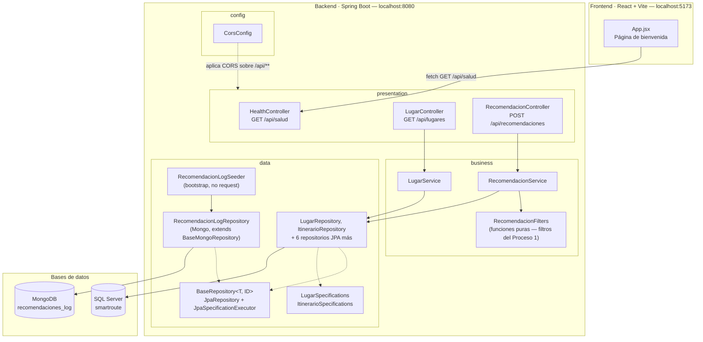

# Diagrama de arquitectura — SmartRoute

Arquitectura en capas del backend (Spring Boot) y su interacción con el frontend (React) y las
bases de datos. Refleja el código entregado a la fecha (Laboratorios 1 a 3): el flujo de negocio de
`Lugar` y la recomendación del Proceso 1, más los repositorios generalizados, las consultas de
negocio y la corrección del problema N+1 del Laboratorio 3
(ver [docs/consultas-negocio.md](consultas-negocio.md)).

**Nota de fidelidad:** `RecomendacionLogRepository` y la colección `recomendaciones_log` de Mongo
existen y están sembradas (Laboratorio 2), pero hoy solo las alimenta `RecomendacionLogSeeder` al
arrancar la aplicación — `RecomendacionService` todavía no escribe ahí cada vez que genera una
recomendación real. Conectar ambas cosas es un paso pendiente (ver más abajo).

## Capas y responsabilidades

| Capa | Paquete | Responsabilidad | Contenido actual |
| --- | --- | --- | --- |
| Presentación | `cr.ac.una.smartroute.presentation` | Recibe peticiones HTTP, valida forma de entrada y devuelve DTOs (nunca entidades JPA). | `HealthController`, `LugarController`, `RecomendacionController`, DTOs en `presentation.dto`. |
| Negocio | `cr.ac.una.smartroute.business` | Reglas, cálculos y validaciones del dominio. No conoce HTTP; no construye SQL. | `LugarService`, `RecomendacionService`, y `RecomendacionFilters` — los cuatro filtros del Proceso 1 como funciones puras, probadas con JUnit sin Spring ni base de datos (`RecomendacionFiltersTest`). |
| Datos | `cr.ac.una.smartroute.data` | Acceso y persistencia. | 8 entidades JPA + repositorios generalizados (`BaseRepository` con soporte de Specifications) sobre SQL Server, y `RecomendacionLog` + `BaseMongoRepository` sobre MongoDB. Dos consultas JPQL y dos Specifications documentadas en [docs/consultas-negocio.md](consultas-negocio.md). |
| Configuración | `cr.ac.una.smartroute.config` | Configuración transversal, fuera del flujo de negocio. | `CorsConfig`. |

## Regla de dependencia

Las dependencias fluyen en una sola dirección: **presentación → negocio → datos**. Por ejemplo,
`RecomendacionController` nunca llama a `LugarRepository` directamente — pasa siempre por
`RecomendacionService`, que es quien conoce tanto las reglas (`RecomendacionFilters`) como el dato
real. La razón de esta regla, y las alternativas que se descartaron, están documentadas en
[ADR-001](adr/ADR-001-arquitectura-en-capas.md).

## Frontend

El frontend (`frontend/`, React + Vite) es un cliente independiente que hoy solo consume
`GET /api/salud` para validar la conexión; consumir `/api/lugares` y `/api/recomendaciones` queda
para un laboratorio posterior.

## Próximos pasos

- Que `RecomendacionService` escriba en `recomendaciones_log` cada vez que resuelve una
  recomendación real (hoy la colección solo tiene los documentos de ejemplo del seeder).
- Confirmación de itinerario (Proceso 2) como transacción — Laboratorio 4.
