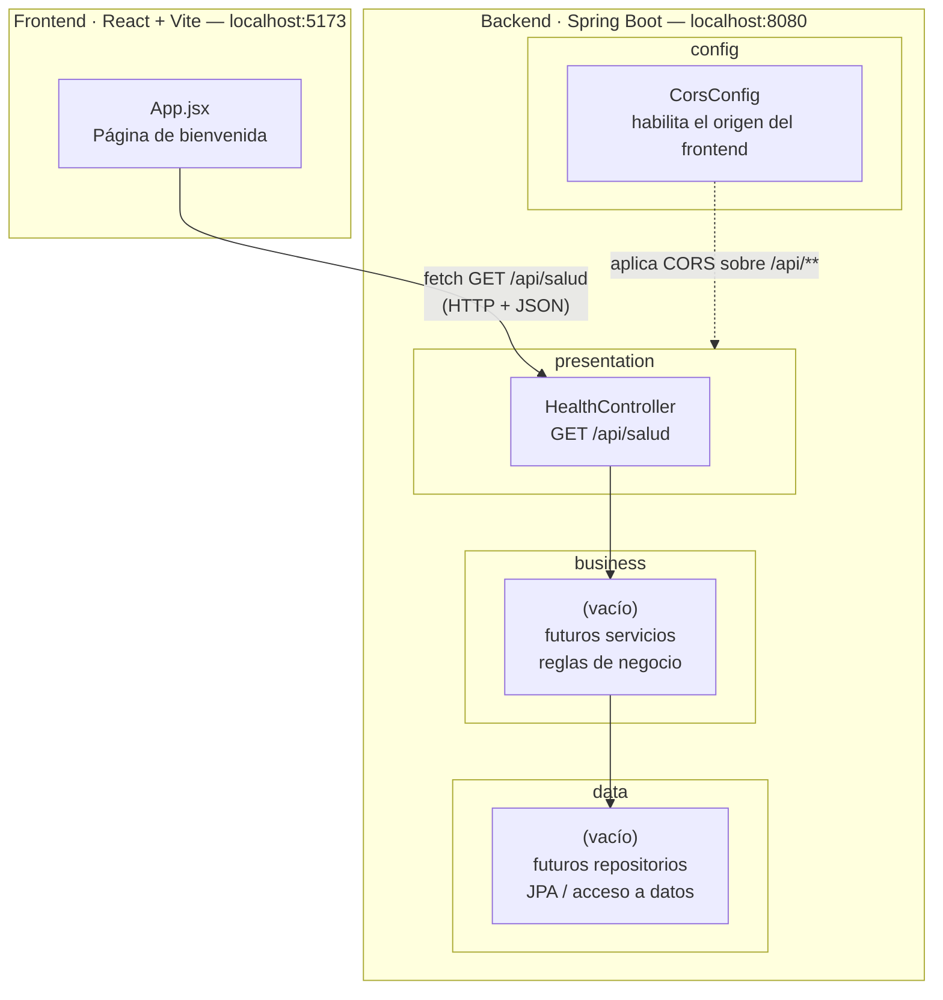

# Diagrama de arquitectura — SmartRoute

Arquitectura en capas del backend (Spring Boot) y su interacción con el frontend (React). Refleja
el estado actual del código entregado en el Laboratorio 1: solo existen `HealthController`
(presentation) y `CorsConfig` (config); `business` y `data` están creadas pero vacías, listas para
crecer en los próximos laboratorios.

## Capas y responsabilidades

| Capa | Paquete | Responsabilidad | Estado actual |
| --- | --- | --- | --- |
| Presentación | `cr.ac.una.smartroute.presentation` | Recibe peticiones HTTP y devuelve respuestas (controladores REST). | `HealthController` con `GET /api/salud`. |
| Negocio | `cr.ac.una.smartroute.business` | Reglas de negocio, validaciones y cálculos. No conoce HTTP ni la base de datos directamente. | Vacío, pendiente de las entidades/procesos de la Propuesta de Dominio. |
| Datos | `cr.ac.una.smartroute.data` | Acceso y persistencia de datos (repositorios). | Vacío, pendiente de definir el modelo de datos. |
| Configuración | `cr.ac.una.smartroute.config` | Configuración transversal de la aplicación (no es parte del flujo de negocio). | `CorsConfig`, que habilita al frontend (`localhost:5173`) a consumir `/api/**`. |

## Regla de dependencia

Las dependencias fluyen en una sola dirección: **presentación → negocio → datos**. Un controlador
puede invocar un servicio; un servicio nunca debe conocer la capa de presentación. `config` es
transversal: no participa en el flujo de negocio, pero afecta cómo la capa de presentación acepta
peticiones (en este caso, CORS).

## Frontend

El frontend (`frontend/`, React + Vite) es un cliente independiente que consume la API del backend
por HTTP. Hoy solo hace `fetch` a `GET /api/salud` para validar la conexión; a partir del
Laboratorio 2 en adelante irá consumiendo los endpoints reales de negocio.
