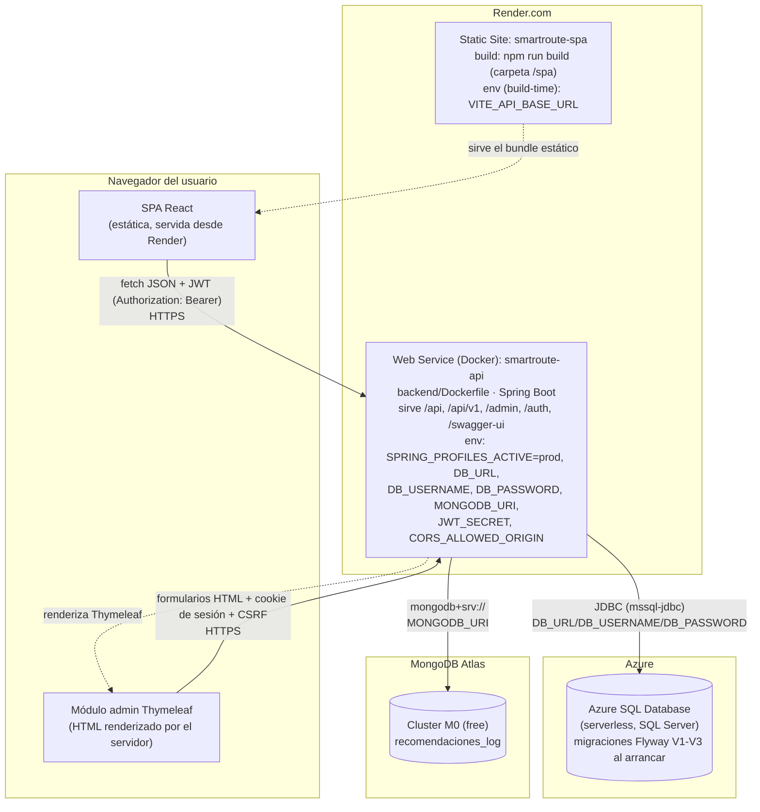

# Diagrama de despliegue — SmartRoute (Laboratorio 6)

Cuatro servicios gestionados, cada uno con su propio ciclo de vida, conectados por URL pública
(HTTPS) o cadena de conexión — nunca por IP fija ni código compartido en el mismo proceso.

## Dónde se configura cada variable

| Variable | Dónde se define | Contiene |
| --- | --- | --- |
| `SPRING_PROFILES_ACTIVE` | Render → `smartroute-api` → Environment | `prod` (activa `application-prod.properties`) |
| `DB_URL`, `DB_USERNAME`, `DB_PASSWORD` | Render → `smartroute-api` → Environment (secretas) | Cadena de conexión y credenciales de Azure SQL Database |
| `MONGODB_URI` | Render → `smartroute-api` → Environment (secreta) | Cadena de conexión `mongodb+srv://` de MongoDB Atlas |
| `JWT_SECRET` | Render → `smartroute-api` → Environment (secreta) | Clave HMAC para firmar JWT — **distinta** de `smartroute.jwt.secret` en `application-dev.properties` |
| `CORS_ALLOWED_ORIGIN` | Render → `smartroute-api` → Environment | URL pública de `smartroute-spa` (p. ej. `https://smartroute-spa.onrender.com`) |
| `PORT` | La inyecta Render automáticamente | Puerto que Spring Boot debe escuchar (`server.port=${PORT:8080}`) |
| `VITE_API_BASE_URL` | Render → `smartroute-spa` → variable de **build** | URL pública de `smartroute-api`; Vite la incrusta en el bundle al compilar, no es una variable de runtime del navegador |

## Flujo de una petición — SPA hasta la base de datos

1. El navegador carga el bundle estático de `smartroute-spa` (ya tiene `VITE_API_BASE_URL`
   incrustado desde el build).
2. El usuario inicia sesión: `POST {VITE_API_BASE_URL}/auth/login` → `smartroute-api` valida la
   contraseña contra `usuario.password_hash` (Azure SQL) y devuelve un JWT firmado con
   `JWT_SECRET`.
3. Cada petición siguiente (`GET /api/v1/itinerarios`, `POST /api/v1/itinerarios`, …) lleva
   `Authorization: Bearer <token>`. `JwtAuthenticationFilter` lo valida sin tocar la base —el JWT
   es autocontenido— y puebla el contexto de seguridad con el `usuarioId` y el rol.
4. El controlador `/api/v1` delega en la capa de negocio (`business`), que usa JPA/Hibernate sobre
   `DB_URL` (Azure SQL) para leer o escribir, dentro de una transacción cuando aplica (Proceso 2).
5. La respuesta vuelve como JSON (Problem Details si fue un error) directo al `fetch` de la SPA.

El módulo `/admin` sigue el mismo backend pero un camino distinto: sesión de servidor (cookie)
en vez de JWT, CSRF activo, y las vistas HTML las renderiza Thymeleaf en el propio
`smartroute-api` — no hay una SPA de por medio ni una build aparte.

## Por qué Azure SQL (no un Postgres gestionado) para la base relacional

El proyecto usa SQL Server desde el Laboratorio 2 (desviación documentada y aprobada respecto al
Postgres de referencia del curso). Azure SQL Database es el mismo motor como servicio gestionado
—mismo dialecto T-SQL, mismo driver `mssql-jdbc`, mismas migraciones de Flyway sin cambios— así
que no hace falta reescribir nada de la capa de datos para desplegar; solo apuntar `DB_URL` a la
instancia de Azure. Su tier serverless (auto-pausa tras inactividad) es el más cercano en
comportamiento al "plan gratuito que se suspende" que ya contempla la rúbrica para Render/Railway.
