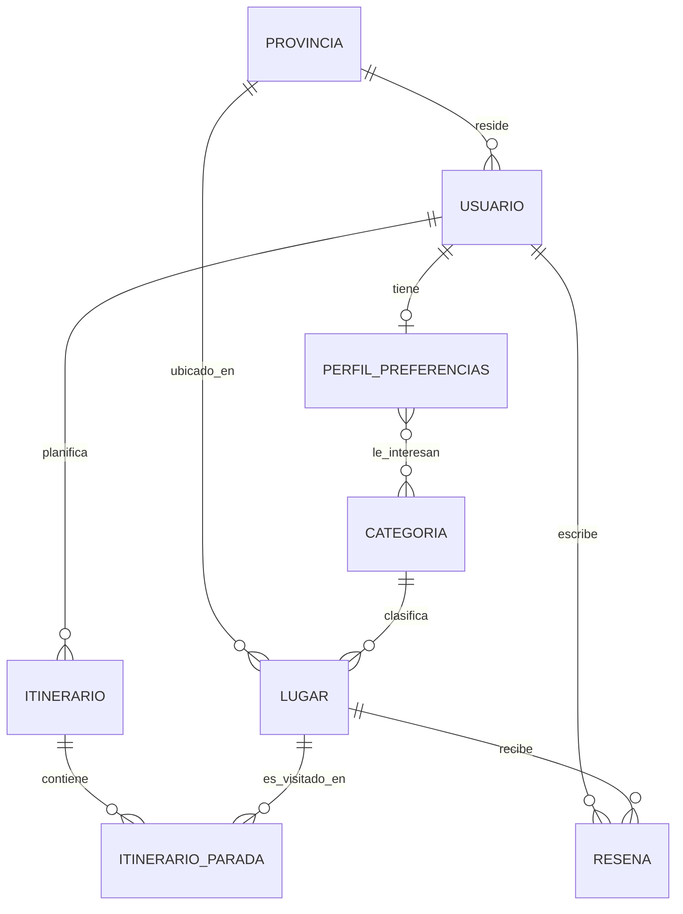

# Modelo de datos — SmartRoute (Laboratorio 2)

Persistencia políglota sobre el dominio propuesto en el Laboratorio 1: un núcleo transaccional en
**SQL Server** (entidades relacionadas, con integridad referencial y reglas de negocio como
restricciones) y una parte documental en **MongoDB** (bitácora de recomendaciones).

## Nota sobre el motor relacional

La guía del laboratorio usa PostgreSQL como referencia. Este proyecto usa **SQL Server** en su
lugar, con autorización del profesor para libertad de stack. La diferencia técnica más relevante:
la imagen oficial de SQL Server no crea la base de datos de la aplicación a partir de variables de
entorno (a diferencia de `POSTGRES_DB`), así que tanto `docker-compose.yml` como el CI incluyen un
paso explícito que la crea (`CREATE DATABASE smartroute`) antes de que la aplicación se conecte.

## Modelo relacional (SQL Server, 3FN)



### Por qué está en 3FN

- **Sin grupos repetidos (1FN):** las "categorías de interés" de un perfil no se guardan como una
  lista en una columna; se normalizan en la tabla de unión `perfil_preferencias_categoria`.
- **Sin dependencias parciales (2FN):** todas las tablas usan una clave primaria simple (`id`) o,
  en la tabla de unión, una clave compuesta donde ambos atributos no clave (ninguno, en este caso)
  dependen de la clave completa.
- **Sin dependencias transitivas (3FN):** por ejemplo, `lugar.nivel_accesibilidad` depende
  directamente de `lugar.id`, no de `lugar.categoria_id`; no se duplica el nombre de la provincia o
  categoría en `lugar`, solo su FK.

### Restricciones y por qué existen

| Restricción | Tabla | Razón |
| --- | --- | --- |
| `UNIQUE(correo)` | `usuario` | Regla de negocio: no puede haber dos cuentas con el mismo correo. |
| `UNIQUE(usuario_id)` en `perfil_preferencias` | `perfil_preferencias` | Modela la relación 1:1 con `usuario`. |
| `CHECK(nivel_accesibilidad IN ('ALTA','MEDIA','BAJA'))` | `lugar` | Evita valores libres inconsistentes; son los 3 niveles que usa el Proceso 1 (recomendación). |
| `CHECK(hora_fin > hora_inicio)` | `itinerario_parada` | Regla del Proceso 2: una parada no puede terminar antes de empezar. |
| `UNIQUE(itinerario_id, orden)` | `itinerario_parada` | Evita dos paradas con el mismo orden dentro de un itinerario. |
| `UNIQUE(usuario_id, lugar_id)` | `resena` | Un usuario reseña un lugar una sola vez. |
| `ON DELETE CASCADE` solo en `perfil_preferencias`, `perfil_preferencias_categoria` e `itinerario_parada` | — | Son datos de detalle que no tienen sentido sin su dueño. El resto de FKs queda `NO ACTION` a propósito: SQL Server rechaza esquemas donde una tabla es alcanzable por más de una ruta de cascada desde el mismo origen. |

### Índices y por qué

| Índice | Justificación |
| --- | --- |
| `lugar(provincia_id)`, `lugar(categoria_id)` | Son los dos filtros del Proceso 1 (recomendación): "lugares de esta provincia y esta categoría". |
| `itinerario(usuario_id)` | Consulta más frecuente: "mis itinerarios". |
| `itinerario_parada(itinerario_id)` | Las paradas siempre se leen juntas, agrupadas por itinerario. |
| `resena(lugar_id)` | Necesaria para calcular el promedio de calificación de un lugar. |

## MongoDB — colección `recomendaciones_log`

Cada vez que el motor de recomendación (Procesos 1 y 2 del dominio) le genera sugerencias a un
usuario, se guarda un documento con los criterios usados y los lugares/planes sugeridos **en ese
momento**.

```json
{
  "_id": "...",
  "usuarioId": 1,
  "fecha": "2026-08-25T03:35:35Z",
  "criterios": {
    "provinciaId": 1,
    "categorias": ["Natural", "Cultural"],
    "presupuestoMaximo": 20000.00,
    "tieneTransportePropio": false
  },
  "lugaresSugeridos": [
    { "lugarId": 3, "nombre": "Museo Nacional de Costa Rica", "categoria": "Histórica", "costoEstimado": 3000.00, "score": 0.91 }
  ],
  "planesGenerados": [
    {
      "paradas": [
        { "lugarId": 3, "nombre": "Museo Nacional de Costa Rica", "orden": 1, "horaInicio": "09:00", "horaFin": "11:00" }
      ],
      "costoTotal": 8000.00,
      "duracionMinutos": 240,
      "score": 0.85
    }
  ]
}
```

### Justificación (las 3 preguntas de diseño)

1. **¿Cómo se lee el 90% del tiempo?** Completo, como un solo evento histórico: "qué le
   recomendé a este usuario y por qué". Nunca se necesita un criterio o un lugar sugerido por
   separado del resto del evento → se **incrusta** todo dentro del mismo documento.
2. **¿Cuánto crece en el peor caso?** Sin límite: cada solicitud de recomendación agrega un
   documento nuevo. Por eso **no** se incrusta dentro de un documento `usuario` (no existe tal
   documento — el usuario vive en SQL Server — y aunque existiera, crecería indefinidamente). Es
   una colección propia, y `usuarioId` es una **referencia** simple (un campo plano) hacia la fila
   real en SQL Server: persistencia políglota, no una relación de Mongo.
3. **¿Quién más lo necesita?** Casi nadie más que el propio usuario (ver su historial) y,
   eventualmente, analítica interna. No hay necesidad de que otras partes del sistema naveguen
   estos documentos desde otras colecciones, así que no se justifica partirlo más ni referenciarlo
   desde otro lado.

Las **Reseñas**, en cambio, se quedaron en SQL Server: necesitan agregación (promedio de
calificación por lugar), algo que el modelo relacional resuelve mejor que un documento.

## Cómo levantar todo

```bash
docker compose up -d          # SQL Server + Mongo (crea la base "smartroute" automáticamente)
cd backend
./gradlew bootRun             # aplica las migraciones Flyway y siembra Mongo al arrancar
```

Verificación rápida:

```bash
curl http://localhost:8080/actuator/health   # "status":"UP"
```

Las migraciones viven en `backend/src/main/resources/db/migration/` (`V1__esquema_inicial.sql`,
`V2__datos_semilla.sql`) y corren solas al iniciar la aplicación — no requieren un paso manual.
